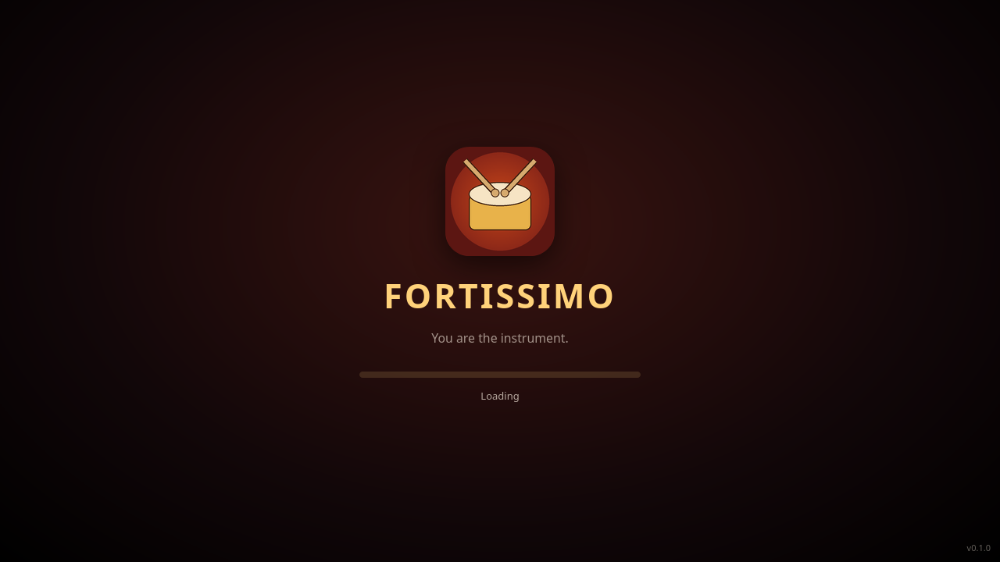
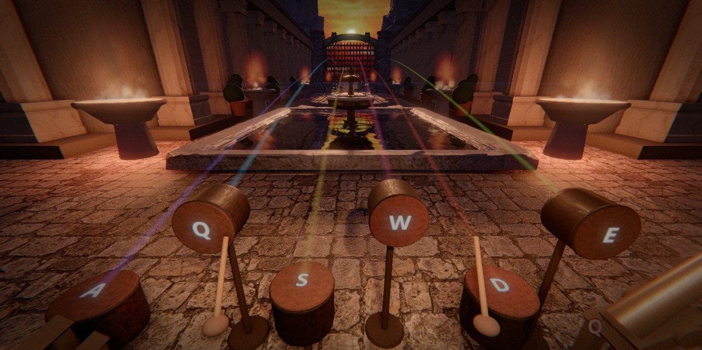
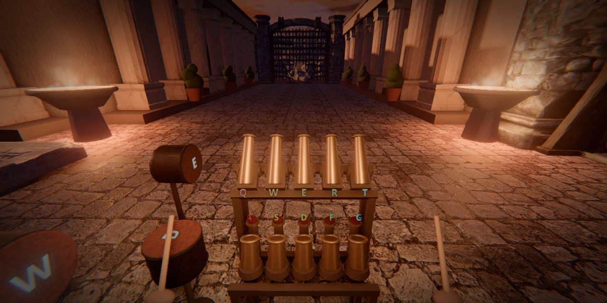
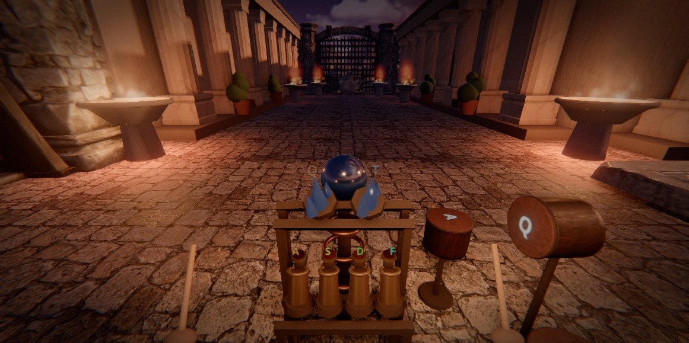
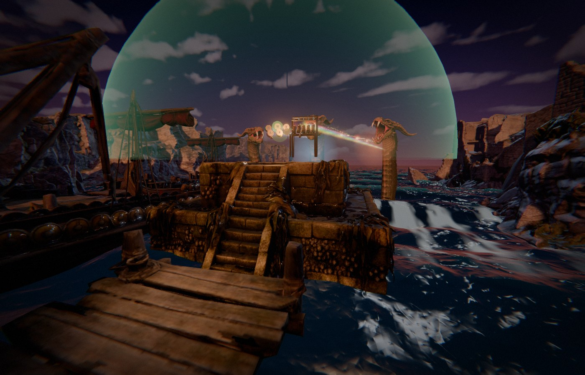
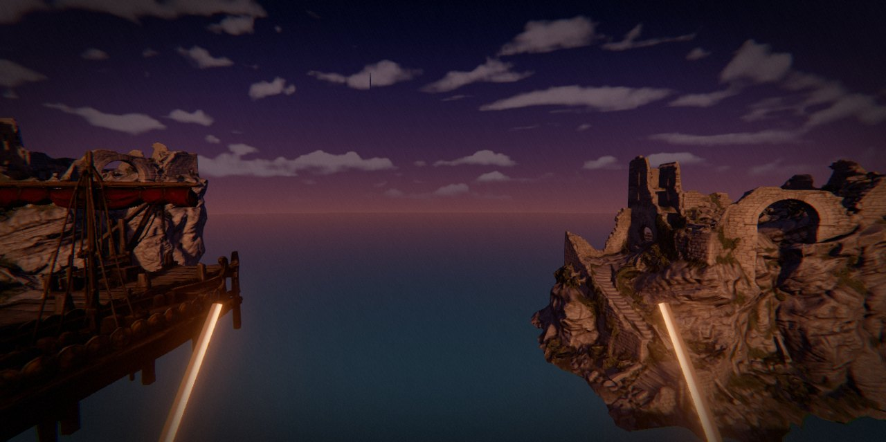

<p align="center"></p>

<h1 align="center">FORTISSIMO</h1>
<p align="center"><b>The rhythm game where you are the instrument.</b><br>
A Roman garden under siege. Every drum you hit raises the shield. Every mortar you fire on the beat knocks an arrow out of the sky.<br>
Then the sea gate rises, and the Hydra comes.</p>

<p align="center">


</p>

## What it is

You don't press buttons to match a chart — your press **makes the sound**, instantly, and the game judges how close to the beat you landed.
Hit it clean and the note rings full; late and it comes in quiet and off. The town hears the difference, and so does the siege.

A level is three rounds and a finale:

| Round | You play | What it does |
|---|---|---|
| **1 — Drums** | the kit in front of you | holds the shield up over the town |
| **2 — Guns** | a row of mortars | each shot on the beat stops an arrow |
| **3 — Boss** | the lightning crystals | charge them to strike the siege engine |
| **4 — The Hydra** | drums *and* guns at once | drums keep the shield up against the acid; notes parry the heads |

Keyboard, touch, and game controllers all work. There's a built-in song maker, timing calibration for any device, five difficulties and a full set of modifiers.

## Screenshots

<p align="center"></p>
<p align="center"> </p>
<p align="center"></p>
<p align="center"></p>

## Play the demo

The demo ships with the three original rounds — the songs are placeholders while the real score is being written, so expect them to be a bit goofy. The game underneath is the real thing.

```bash
npm install
npm run dev        # http://localhost:5180
```

Phone: open the dev server's address on the same network (or the https door, `tools/https-door.mjs`, to install it as an app).
Desktop: `npm run desktop`. Android: `npm run release` walks through building the APK.

**Controls (keyboard):** drums `Q W E A S D` · mortars `A S D F` / `Q W E R` · Hydra: drums `Q W E A S` + guns `J K L I O`. `Esc` for options.

## Status

A playable demo of one level, being turned into a full game. In progress, in rough order:

- [x] the three rounds and the Hydra finale
- [x] phone and desktop builds, loading screen, saves, calibration
- [ ] the real songs — six, four parts each (intro / verse / prechorus / chorus), one per level
- [ ] a tutorial first level
- [ ] the arenas rebuilt in Blender
- [ ] store release (Android first)

## Built with

[three.js](https://threejs.org) · [Vite](https://vitejs.dev) · [Capacitor](https://capacitorjs.com) · [Electron](https://www.electronjs.org) ·
recorded instruments from [VCSL](https://vis.versilstudios.com/vcsl.html), [VSCO-2 CE](https://vis.versilstudios.com/vsco-community.html) and [NSynth](https://magenta.tensorflow.org/datasets/nsynth) ·
full credits in [public/legal/credits.md](public/legal/credits.md).

## Licence

© Tabulanis. The source is public so you can see the game being made and play the demo; it is **not** licensed for reuse — all rights reserved. The sound libraries and fonts keep their own licences (see credits).
